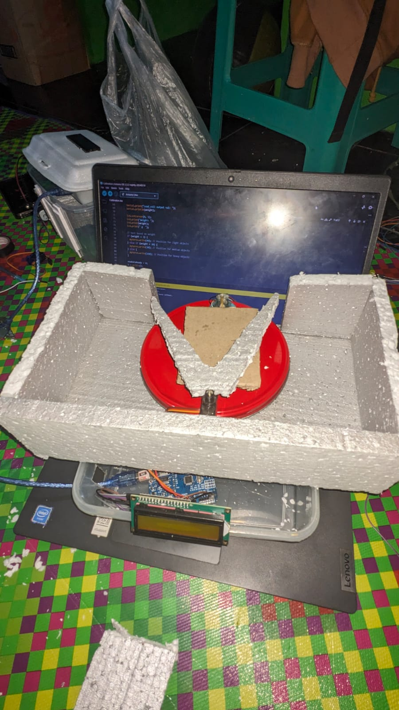
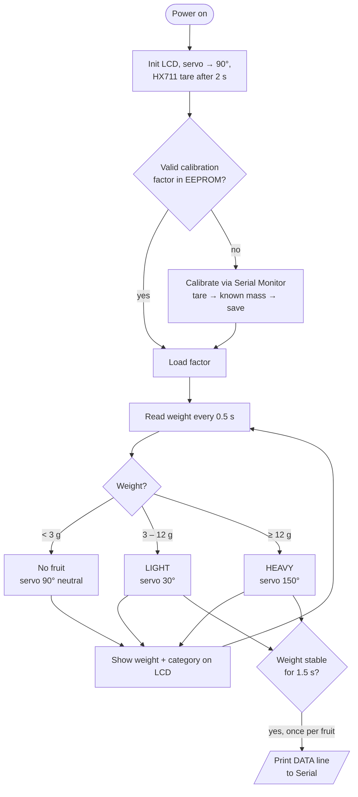
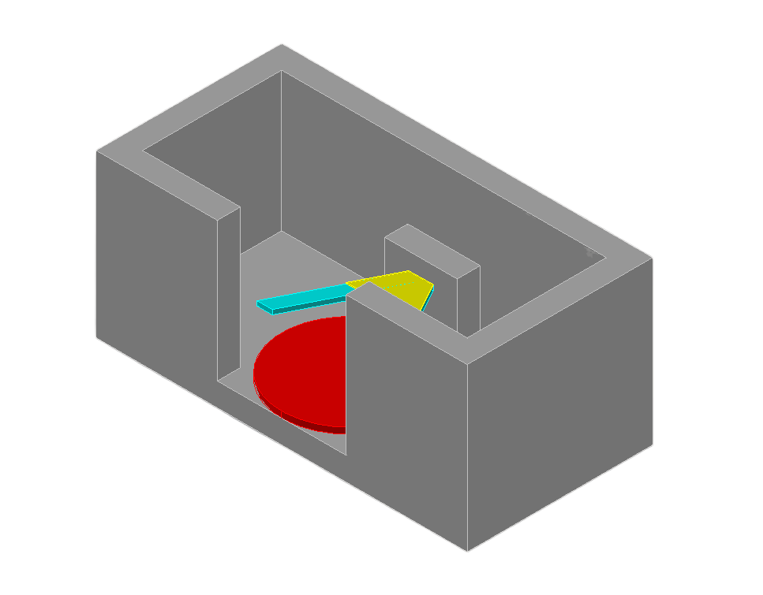
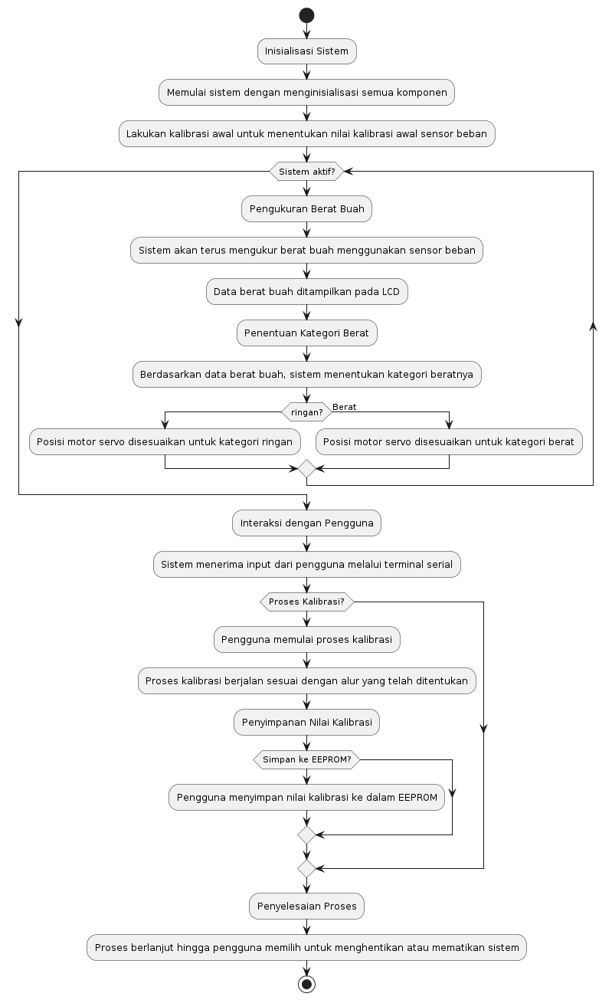
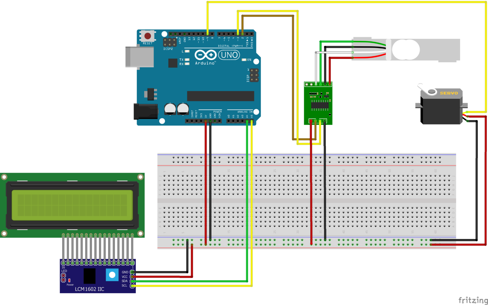
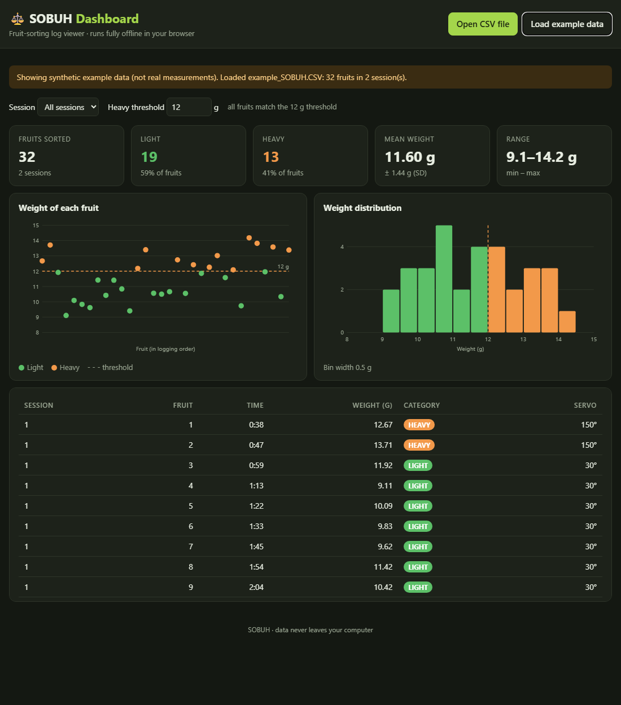

<div align="center">

# ⚖️ SOBUH — Fruit Sorter by Weight

**Weigh it. Sort it. Automatically.** 🍋

An Arduino-based system that weighs each fruit with a **load cell + HX711**, uses a **servo** to push it into the right bin,<br>
shows the weight live on a **16×2 I2C LCD**, and prints a data line for every fruit over **Serial**. A small offline **web dashboard** turns that output into statistics and charts.


-yellow)


[How it works](#-how-it-works) •
[Hardware](#-hardware) •
[Wiring](#-wiring) •
[Getting started](#-getting-started) •
[Calibration](#%EF%B8%8F-calibration) •
[Data output](#-data-output) •
[Dashboard](#-dashboard) •
[Results](#-results)



<sub>The working prototype: weighing platform (red) with the servo-driven deflector, the LCD and Arduino underneath.</sub>

</div>

> [!NOTE]
> **About this project.** SOBUH (*Sistem Sortir Buah* — fruit sorting system) was built in **2024** as the final project of the *Instrumentation and Control* lab course at IPB University. In **2026** I turned it into this repository with the help of **Claude** (Anthropic's AI assistant): the original sketch is preserved in [`original/`](original/), and an improved version with the **same sorting logic** lives in [`sobuh/`](sobuh/). A simple offline [dashboard](dashboard/) was added to view the recorded data.

> [!NOTE]
> The improved sketch has **not yet been tested on the physical hardware**. The original 2024 sketch is the one that ran on the prototype. The dashboard was tested in a browser with example data and simulated Serial Monitor output.

---

## 💡 Why

Sorting fruit by hand is slow, tiring and inconsistent. SOBUH is a low-cost proof of concept for **automatic weight-based grading**: put a fruit on the platform, and the system measures it and routes it to the correct bin, with no human judgement involved.

## ✨ Features

- ⚖️ **Gram-level weighing** with a load cell and the 24-bit HX711 ADC
- 🔀 **Automatic sorting** into *light* and *heavy* bins by a servo-driven deflector
- 📟 **Live readout** of weight and category on a 16×2 I2C LCD
- 🎯 **Two-point calibration** (tare + known mass) from the Serial Monitor, **saved to EEPROM**
- ⌨️ **Serial commands** to tare, recalibrate or edit the calibration factor
- 🧾 **Data output:** one `DATA,` line per sorted fruit on the Serial Monitor (session, number, time, weight, category)
- 📈 **Offline web dashboard:** paste the Serial Monitor output to see totals, charts and a table, with no install and no internet
- 💸 **Cheap:** about **Rp 183,000** in parts, with styrofoam and a lunch box as the enclosure

---

## 🧠 How it works



### The measurement chain

1. **Load cell.** A strain-gauge bar that bends very slightly under load, changing its electrical resistance in proportion to the force.
2. **HX711.** Amplifies the tiny millivolt signal from the load cell's Wheatstone bridge and converts it with a **24-bit ADC**.
3. **Calibration.** The raw reading is converted to grams with a *calibration factor*, found by weighing a known mass.
4. **Decision.** The weight is compared with two thresholds, and the servo turns the deflector to the matching angle.

### Sorting rule

| Weight | Category | Servo angle | LCD |
|:--|:--|:--:|:--|
| `< 3 g` | No fruit on the platform | **90°** (neutral) | `Place a fruit` |
| `3 g ≤ w < 12 g` | **Light** | **30°** | `LIGHT -> bin A` |
| `≥ 12 g` | **Heavy** | **150°** | `HEAVY -> bin B` |

The 12 g boundary was chosen for the test fruit (key limes, *jeruk nipis*). Change `EMPTY_BELOW_G` and `HEAVY_FROM_G` at the top of the sketch for other fruits.

<details>
<summary><b>📐 Original design documents</b></summary>

<br>

| 3D design (AutoCAD) | Original flowchart (in Indonesian) |
|:--:|:--:|
|  |  |

</details>

---

## 🔧 Hardware

| # | Component | Qty | Price (IDR) |
|:-:|:--|:-:|--:|
| 1 | Arduino Uno R3 | 1 | 56,000 |
| 2 | Breadboard (project board) | 1 | 10,000 |
| 3 | 16×2 LCD with I2C backpack (LCM1602 IIC) | 1 | 25,000 |
| 4 | Servo motor (hobby micro servo) | 1 | 17,000 |
| 5 | Jumper wires, male–male | 2 sets | 20,000 |
| 6 | Jumper wires, male–female | 2 sets | 20,000 |
| 7 | Load cell + HX711 module | 1 | 30,000 |
| 8 | Instant noodles 🍜 *(yes, it's in the original budget)* | 1 | 5,000 |
| | **Total (2024 prototype)** | | **Rp 183,000** |


**Mechanical parts:** styrofoam sheets, a plastic lunch box, hot glue and a cutter.

---

## 🔌 Wiring

<div align="center">

</div>

| From | To | Notes |
|:--|:--|:--|
| HX711 **DT** | Arduino **D3** | `HX711_DOUT_PIN` |
| HX711 **SCK** | Arduino **D2** | `HX711_SCK_PIN` |
| HX711 **VCC / GND** | 5V / GND | via breadboard rails |
| Load cell **red / black / white / green** | HX711 **E+ / E− / A− / A+** | typical color code; if the weight reads negative, swap A− and A+ |
| Servo **signal** | Arduino **D9** | `SERVO_PIN` (PWM) |
| Servo **V+ / GND** | 5V / GND | via breadboard rails |
| LCD I2C **SDA** | Arduino **A4** | |
| LCD I2C **SCL** | Arduino **A5** | |
| LCD I2C **VCC / GND** | 5V / GND | I2C address `0x27` (try `0x3F` if blank) |


> [!TIP]
> A servo can draw current spikes that make the HX711 reading jump. If you see noisy weights while the servo moves, power the servo from a separate 5 V supply (with a shared GND) or add a 470–1000 µF capacitor across its supply.

---

## 🚀 Getting started

1. **Install the [Arduino IDE](https://www.arduino.cc/en/software).**
2. **Install the libraries** (*Tools → Manage Libraries…*):
   - **HX711_ADC** by Olav Kallhovd
   - **LiquidCrystal I2C** by Frank de Brabander
   - **Servo** (bundled with the IDE)
3. **Open** [`sobuh/sobuh.ino`](sobuh/sobuh.ino), select **Arduino Uno** and the right port, and **upload**.
4. **Open the Serial Monitor** at **9600 baud**. On the first run there is no calibration stored yet, so follow the calibration steps below.

```text
sobuh-fruit-sorter/
├── sobuh/
│   └── sobuh.ino                 # ✅ recommended sketch (improved)
├── original/
│   ├── README.md                 # what changed and why
│   └── sobuh_original/
│       └── sobuh_original.ino    # sketch exactly as in the 2024 report
├── dashboard/
│   ├── index.html                # 📈 offline dashboard (open in a browser)
│   └── example_data.csv          # synthetic example data
├── docs/images/                  # wiring, 3D design, flowchart, photos, screenshots
├── LICENSE                       # MIT
├── THIRD_PARTY_NOTICES.md        # HX711_ADC (MIT) notice
└── README.md
```

---

## 🎚️ Calibration

Calibration converts the HX711's raw numbers into grams. You only need to do it **once**: the factor is saved to EEPROM and loaded automatically at every start-up.

| Step | You do | Serial Monitor / LCD |
|:-:|:--|:--|
| 1 | Leave the platform **empty** and send `t` | `Calibration 1/2` → `Tare complete` |
| 2 | Place a **known mass** (e.g. a 100 g weight) and send its value, e.g. `100.0` | `Calibration 2/2` → new factor printed |
| 3 | Send `y` to **save** it to EEPROM | `Save to EEPROM?` → `Value … saved` |

**Serial commands at any time:**

| Key | Action |
|:-:|:--|
| `t` | Tare: set the current load as zero |
| `r` | Run the full calibration again |
| `c` | Type in a calibration factor manually |
| `h` | Show help |

---

## 🧾 Data output

Every fruit is recorded as **one line on the Serial Monitor**, once its weight has been **stable for 1.5 s** (three readings within ±0.5 g). The next fruit is recorded only after the platform has been emptied, so a fruit resting on the scale is never counted twice.

```text
DATA,session,fruit,uptime_s,weight_g,category,servo_deg
Weight: 12.08 g  -> servo 150
DATA,3,1,42,12.11,HEAVY,150
Weight: 0.01 g  -> servo 90
DATA,3,2,55,10.53,LIGHT,30
```

<sub>Illustrative output. The <code>DATA,</code> prefix lets the dashboard pick these lines out of the regular <code>Weight:</code> messages.</sub>

| Field | Meaning |
|:--|:--|
| `session` | Power-on counter stored in EEPROM, which increases at every start-up |
| `fruit` | Fruit number within the session (also shown on the LCD as `#n`) |
| `uptime_s` | Seconds since power-on. The Uno has no real-time clock, so there is no date or time of day |
| `weight_g` | Stable weight in grams |
| `category` | `LIGHT` or `HEAVY` |
| `servo_deg` | Servo angle used for that fruit |

---

## 📈 Dashboard

<div align="center">

<br><sub>Shown with the synthetic example data. It follows your system's light/dark theme.</sub>
</div>

<br>

A single HTML file, [`dashboard/index.html`](dashboard/index.html), that runs **completely offline** in your browser. Your data never leaves your computer.

1. Keep the sorter connected by USB and open the Arduino IDE **Serial Monitor** (9600 baud) while you sort.
2. When you're done, click inside the Serial Monitor output and press <kbd>Ctrl</kbd>+<kbd>A</kbd>, <kbd>Ctrl</kbd>+<kbd>C</kbd>.
3. Double-click `dashboard/index.html` to open it in any modern browser.
4. Click **Paste Serial output**, paste, and press **Show data**.

Only lines containing `DATA,` are used, and Serial Monitor timestamps are fine. You can also save the output as a `.txt`/`.csv` file and use **Open file**, or drag it onto the page.

You get:
- **Summary cards:** fruits sorted, light vs. heavy counts and shares, mean ± SD weight, and range
- **Charts:** the weight of every fruit with the threshold line, and a weight histogram
- **Session filter**, to view one power-on session or all of them
- **What-if threshold:** change the threshold to see how many fruits would switch category
- **Table** of every recorded fruit

No CSV yet? Click **Load example data**, or open `index.html#example`.

> The example data is **synthetic**, generated for demonstration. It is not a real measurement.

---

## 📊 Results

Performance test with key limes, using the **12 g** boundary:

| Fruit | Weight | Category | Servo |
|:--|--:|:--|:--:|
| Lime 1 | 12.11 g | 🟠 Heavy | 150° |
| Lime 2 | 10.53 g | 🟢 Light | 30° |
| Lime 3 | 11.01 g | 🟢 Light | 30° |
| Lime 4 | 13.23 g | 🟠 Heavy | 150° |

**4/4 limes were routed to the correct bin.** After calibration with a known mass, the report states a weighing accuracy above **95 %**.

## ⚠️ Limitations

- **Single-fruit, small-mass setup.** The prototype was tested with small fruit (~10–14 g) and a 3 g "empty" threshold. Heavier produce needs a load cell with a suitable capacity and new thresholds.
- **No conveyor.** Fruit is placed by hand, and the servo only selects the bin.
- **Sorting doesn't wait for a stable weight.** The servo follows every reading (only the *recording* waits for stability), so a fruit dropped onto the platform may be sorted mid-bounce.
- **No real-time clock.** Data lines have an uptime, not a date or time of day.
- **Needs a computer for data.** Data is only captured while the Serial Monitor is open; nothing is stored on the device.
- **Small test set.** The four-sample test demonstrates the concept but does not measure accuracy statistically.

## 🗺️ Ideas for future work

- [x] Output every fruit as data and view it in a **dashboard**
- [ ] Store data on a **microSD card** module (planned in 2024) so no computer is needed
- [ ] Use the stable weight for **sorting** too, not only for recording
- [ ] Add an **RTC module** (e.g. DS3231) for real timestamps
- [ ] Support **more than two grades** with a configurable threshold table
- [ ] Add a **conveyor or chute** for continuous feeding
- [ ] Combine weight with **color** for ripeness-aware sorting (see my other project, [Banadict](https://github.com/regiamuhammad/banadict))

---

## 🙌 Credits

- **Author:** [Muhammad Regia Anbiya](https://github.com/regiamuhammad)
- **Team (Group 1, K3):** Syamsi Wirdiyan, Amalia Divie Soraya, Rizky Amelia
- **Course:** Instrumentation and Control lab, Department of Mechanical and Biosystem Engineering, Faculty of Agricultural Engineering and Technology, IPB University (2024)
- **Calibration routine:** adapted from the *Calibration* example of [HX711_ADC](https://github.com/olkal/HX711_ADC) by Olav Kallhovd (MIT)
- **2026 repository, refactor and dashboard:** prepared with the help of Claude (Anthropic's AI assistant)

## 📄 License

Released under the [MIT License](LICENSE). The adapted HX711_ADC code keeps its own MIT notice; see [THIRD_PARTY_NOTICES.md](THIRD_PARTY_NOTICES.md).
